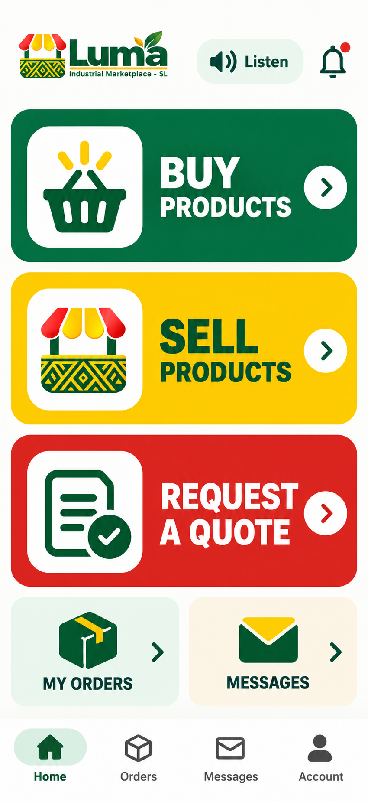
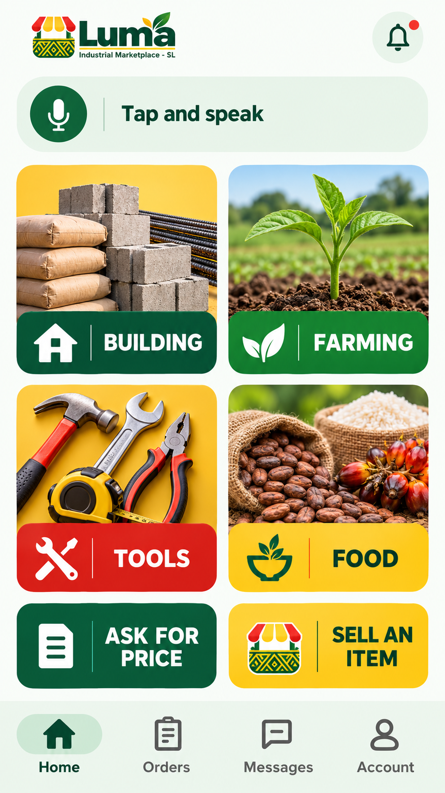
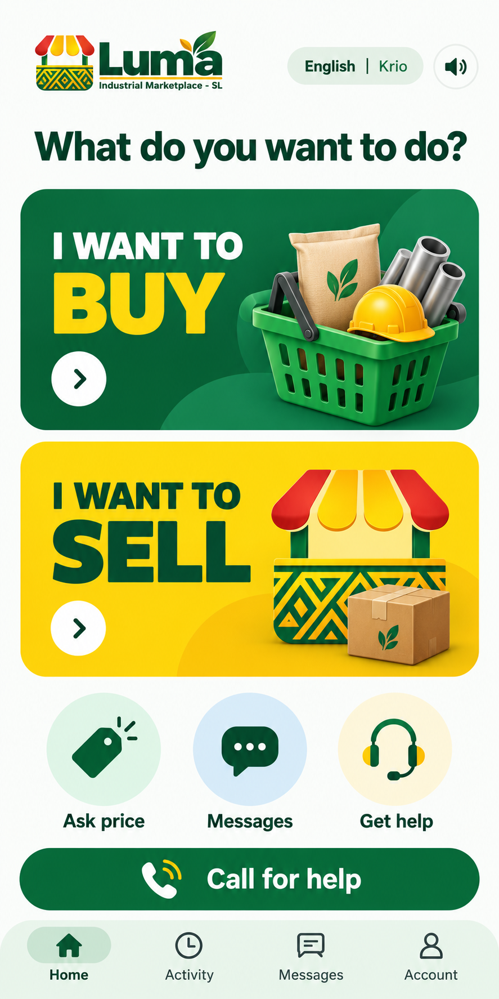

# Luma home-screen variations

These concepts use the supplied adult-literacy figure of approximately 48.64% as a design constraint. They prioritize recognition, short labels, large touch targets, audio assistance, and a small number of choices.

## Inspiration reviewed

- Wasoko supports retailers through the app, a phone call, or a field representative. This supports keeping human help visible rather than burying it in settings.
- Jiji places buying, selling, and visual categories near the top of the marketplace experience.
- Kwanza Tukule uses a prominent search control, image-led categories, direct product actions, and four primary navigation tabs.
- Souq Tajer gives Categories and RFQ prominent positions on its home screen.

## Variation A — Action first

Three full-width actions expose the marketplace's core jobs immediately: buy products, sell products, and request a quote. This is the easiest version to scan and learn.

## Variation B — Visual categories

Four image-led categories help users recognize what they need before reading. Voice search, RFQ, and selling remain available on the first screen.

## Variation C — Guided start

The user makes one initial choice: buy or sell. English/Krio, listening support, price requests, messaging, and phone help remain visible. This is the recommended starting point for usability testing.

## Recommended implementation direction

Use Variation C as the home structure, then add the explicit **Request a quote** action from Variation A. Keep four bottom-navigation destinations: Home, Activity, Messages, and Account. Product categories should appear after the user chooses Buy, instead of competing with the first decision.

Validate the words, icons, Krio translations, audio prompts, and support route with Sierra Leonean buyers and suppliers before release. Measure whether users can begin buying, selling, and requesting a quote without assistance.
